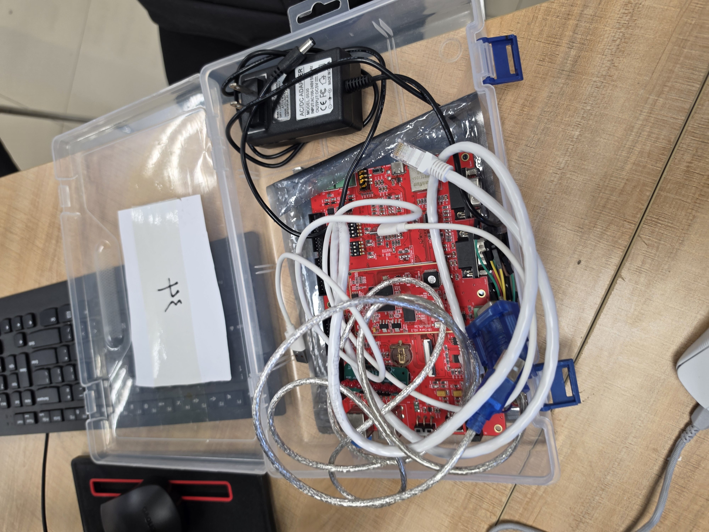
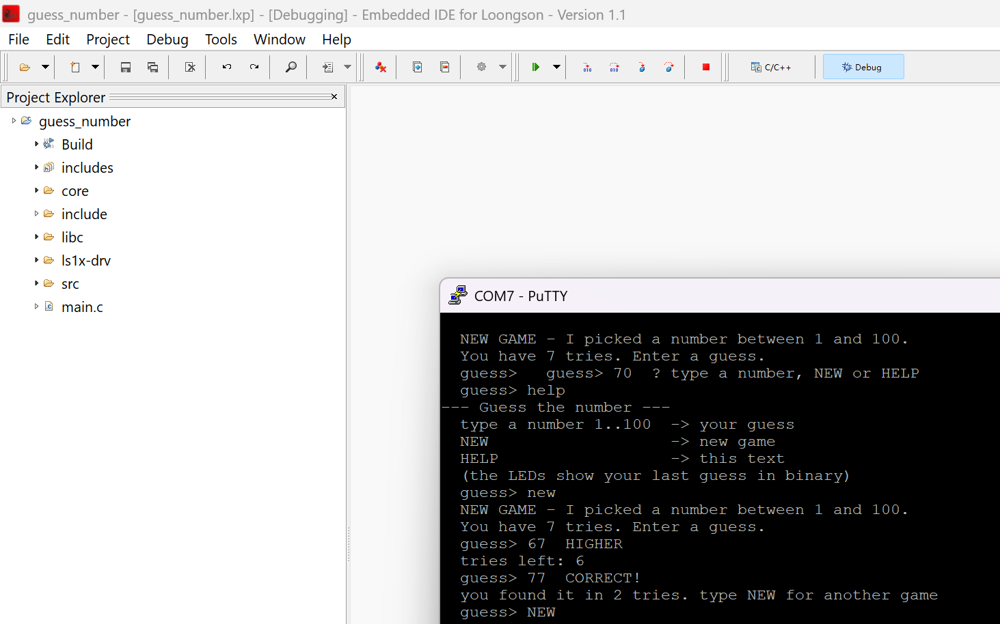
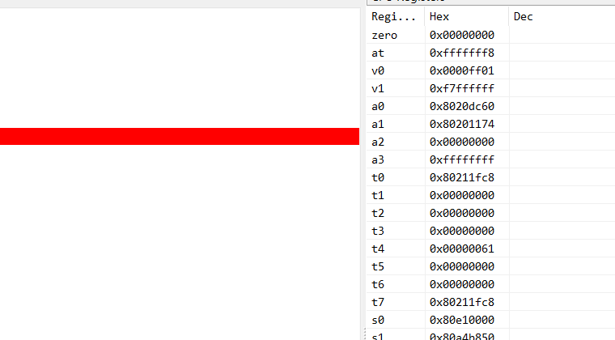
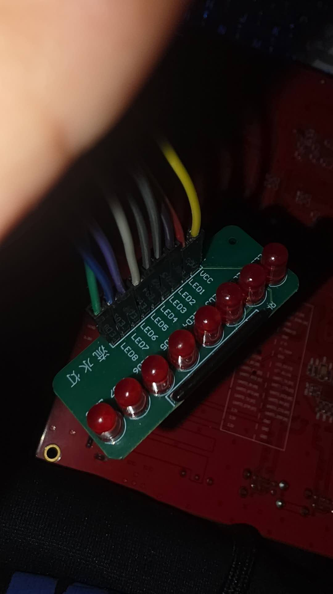
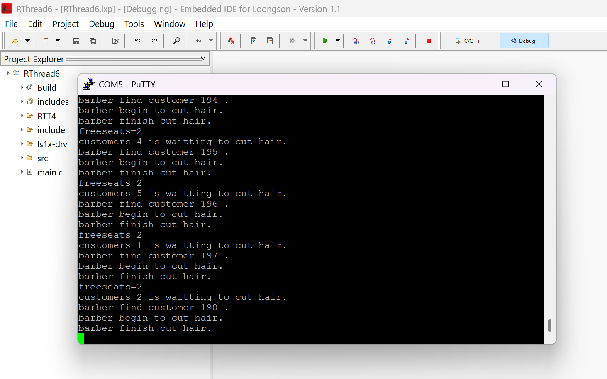
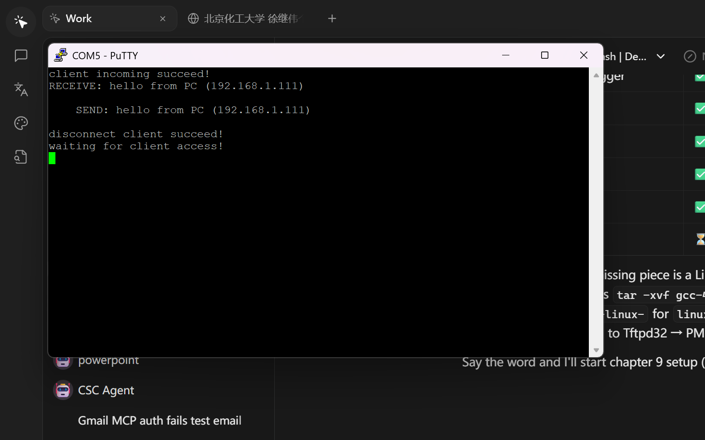
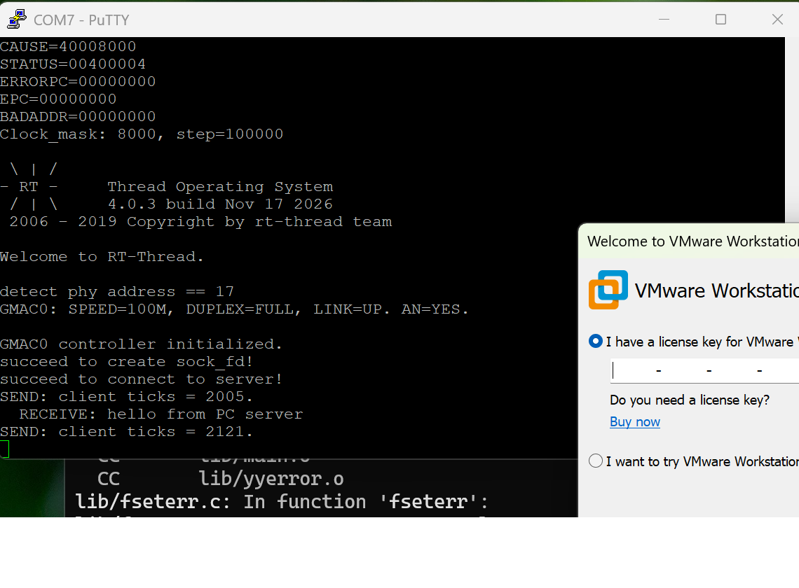

# Loongson 1B — Computer System Comprehensive Design

**A complete bare-metal + RT‑Thread + lwIP course project on a domestic Loongson 1B (LS1B200 / MIPS32) board, with all experiments verified on real hardware and one independent application: a serial guessing game.**

<p align="left">
  
  
  
  
  
</p>



---

## Table of contents

- [What this repository is](#what-this-repository-is)
- [Hardware and software](#hardware-and-software)
- [Results at a glance](#results-at-a-glance)
- [Quick start — build and run a project](#quick-start--build-and-run-a-project)
- [The final project: Guess the Number](#the-final-project-guess-the-number)
- [Project structure](#project-structure)
- [Chapter by chapter](#chapter-by-chapter)
- [Troubleshooting (read this first if nothing builds)](#troubleshooting-read-this-first-if-nothing-builds)
- [Documentation](#documentation)
- [Author](#author)

---

## What this repository is

The course *Computer System Comprehensive Design* joins computer organisation, interface
technology, assembly and C programming, operating systems and networking into one practical
project on an embedded board built around the **Loongson 1B** system on chip. This repository
contains the complete work:

* **six course experiments**, each compiled, downloaded and **observed on the physical board**;
* **one independent application** designed from scratch — a serial **guessing game** that also
  drives the eight on-board LEDs;
* the **report** (Word), the **full source listing** of the game, **console screenshots** and
  **photographs** of the hardware;
* the **helper tools** written along the way (a build script, a project‑file generator, and a
  `make` compatibility shim for Windows 11).

Everything here was produced on a real board — no simulator results are reported as hardware
results.

## Hardware and software

| | |
|---|---|
| **Board** | Loongson 1B, `LS1B200` core `LS232`, MIPS32 Release 2, little‑endian, soft‑float, 64 MB RAM |
| **On‑chip peripherals used** | GPIO, UART3/UART4/UART5, GMAC0 (10/100 Ethernet), timers |
| **Debug probe** | LxLink EJTAG (on‑board FTDI FT2232, USB `VID_0403 PID_6010`) |
| **Serial console** | CH340 USB↔RS232 adapter, 115200 8‑N‑1 |
| **IDE** | LoongIDE 1.1 (`C:\LoongIDE`) |
| **Toolchain** | SDE Lite 4.9.2 for MIPS — `mips-sde-elf-gcc 4.9.2`, `ld 2.24`, `gdb 7.9` |
| **Runtime** | MSYS 1.0 + MinGW (needed by LoongIDE's build system) |
| **RTOS / stack** | RT-Thread 4.0.2, lwIP 1.4.1 (chapters 7 and 8) |
| **Linux build host** | Ubuntu 16.04.7 in VMware Workstation 16 (chapter 9) |
| **Host tools used** | PuTTY, Tftpd32, NetAssist |

## Results at a glance

| Chapter | Topic | Status | Evidence |
|:---:|---|:---:|---|
| 4 | Toolchain, first project, **debugger** | ✅ | live CPU registers, disassembly, single‑stepping |
| 5 | **Assembly** `1+3+5+…=n²` with overflow guard | ✅ | `0xFFFE0001` read back from `0x80030000` |
| 6 | **Serial‑controlled running LED** (8 LEDs, 5 commands) | ✅ | LEDs observed running, commands accepted |
| 7 | **RT‑Thread sleeping barber** (1 barber, 5 customers, 3 chairs) | ✅ | console trace of the thread/semaphore traffic |
| 8 | **TCP + UDP transmission** — all four roles | ✅ | four exchanges measured end‑to‑end |
| 9 | **Porting Linux** | 🟡 partial | cross‑compiler ✅, `vmlinux` written to flash ✅, rootfs too large for the flash partition |
| ★ | **Final project — Guess the Number** | ✅ | 14 test cases, full game won on the board |

## Quick start — build and run a project

**1. Wire the board**

```
white USB-C  → board  ⇄  laptop      (JTAG: download + debug)
blue adapter → 9-pin  ⇄  board UARTx (serial console)   → see note below
5 V adapter  → board power jack,  switch ON
Ethernet     → board RJ45 ⇄ laptop    (only for chapter 8)
```

> **Serial port note.** On this kit the adapter is wired to **UART5**, but on the unit used
> here the working socket turned out to be **UART3/UART4**. The final game therefore writes to
> all three (`UART3/4/5`) and reads from whichever receives — see
> `projects/guess_number/main.c`. If your console stays silent, that is the reason.

**2. Open a console**

PuTTY → *Serial* → the `COMx` that Device Manager shows for `USB-SERIAL CH340` → **115200** → Open.
(The COM number changes between plug‑ins — always check Device Manager first.)

**3. Build and download**

LoongIDE → `File → Open Project` → pick a `.lxp` from `projects/` → **`Debug → Run` (F9)**.
The IDE builds with SDE Lite 4.9.2 and downloads over JTAG. Projects are pre‑configured with
`DownloadByNet=0` (JTAG, not the network boot loader) and `SetBPAtStart=0`.

**4. Interact**

Type in the console. The final project, for example, is played entirely from there (see below).

## The final project: Guess the Number

A small but complete interactive system: the board picks a secret number, the player guesses,
and the **eight LEDs display every guess in binary** while the console reports `HIGHER` /
`LOWER`.

```
=== Loongson 1B : Guess the Number ===
  NEW GAME - I picked a number between 1 and 100.
  You have 7 tries. Enter a guess.
  guess> 67   HIGHER
  tries left: 6
  guess> 77   CORRECT!
  you found it in 2 tries. type NEW for another game
```



**Commands**

| Input | Meaning |
|---|---|
| `1` … `100` | a guess |
| `NEW` | start a new game with a new secret |
| `HELP` | command list |

**Design highlights**

* the secret is seeded from the hardware tick counter (`get_clock_ticks()`), so it differs on
  every run;
* seven tries, with the remaining count printed after each guess;
* invalid input (letters, `0`, `325`, empty line) is rejected without disturbing the game;
* all state is in file‑scope variables — no dynamic allocation at run time;
* the LEDs act as a binary display, LED1 = bit 0 (active low, Table 8.14 wiring).

Source: [`projects/guess_number/main.c`](projects/guess_number/main.c) ·
Full listing: [`docs/guess_number_source_code.docx`](docs/guess_number_source_code.docx)

## Project structure

```
.
├── projects/                  LoongIDE projects (open the .lxp)
│   ├── example_4_1/           chapter 4  – first project, debugger
│   ├── example_7_2/           chapter 5  – assembly summation
│   ├── example_6_1/           chapter 6  – serial controlled LED
│   ├── RThread6/              chapter 7  – RT-Thread sleeping barber
│   ├── example_9_1/           chapter 8  – lwIP TCP/UDP (4 variants, 1 macro)
│   ├── guess_number/          ★ final project
│   └── led_register/          second demo – 8-bit LED register
├── docs/
│   ├── Computer_System_Comprehensive_Design_Report_FINAL.docx   the report
│   ├── guess_number_source_code.docx                            full source listing
│   ├── guess_number_main.c                                      source as plain C
│   └── chapter8_evidence.md                                     network test transcripts
├── media/
│   ├── photos/                board, LED module, pinout
│   └── screenshots/           console captures from the board
└── tools/
    ├── build_project.sh       command-line build with the IDE's exact flags
    ├── add_units.js           generates the project file's source list
    └── make_shim.c            make compatibility shim for Windows 11
```

## Chapter by chapter

### Chapter 4 — Toolchain and the debugger
Bare‑metal project `example_4_1` with Code Listing 4‑1 (`a = ‑100`, `b = ‑10`, `x = a+b`,
`y = a‑b`). Compiled with `-O1`, downloaded over JTAG, stopped at the first line: the CPU
Registers pane shows live core values (`sp=0x80212BA0`, `ra=0x802002CC`, `sr=0x0000FF01`),
the Disassembly pane shows the generated `li / sb / lbu / addu / sll / sra` sequence, and
single stepping with `F6` moves from `x=a+b` to `y=a-b`.



### Chapter 5 — Assembly with overflow protection
Odd‑number summation in `core/bsp_start.S`, using the *remaining space* method (subtract the
running sum from `0xFFFFFFFF` before each addition). The result was read back with
`Debug → View Memory` at `0x80030000`:

```
80030000:  01 00 FE FF   →  0xFFFE0001  (4,294,836,225 = 65535²)
```

matching Table 5‑1 of the guide exactly.

### Chapter 6 — Serial‑controlled running LED
Eight LEDs on GPIO **9, 11, 15, 17, 20, 22, 6, 7** (course Table 8.14), VCC on 3.3 V,
active low. Five commands: `ON n`, `OFF`, `SPEED ms`, `START`, `STOP`, each echoed back.



### Chapter 7 — RT‑Thread sleeping barber
One barber (priority 10) and five customers (priorities 5–9), three chairs, semaphores
`customers` / `barber`, mutex `seatmutex`, counter `freeseats`. The customer releases the mutex
**before** waiting on the barber, which is what prevents deadlock. The captured console trace
shows the full cycle (`barber find customer …`, `freeseats=2`, `customers N is waitting …`).



### Chapter 8 — TCP and UDP, all four roles
One project, four variants selected by a macro in `lwip_test.h`. Board `192.168.1.123`,
PC `192.168.1.111`.

| Role | Port | Measured result |
|---|:---:|---|
| TCP **server** (board) | 9060 | PC's 31 bytes echoed back; console `RECEIVE:` / `SEND:` |
| TCP **client** (board) | 9061 | board connected and sent `client ticks = 2005.` |
| UDP **server** (board) | 9062 | 33‑byte datagram echoed back |
| UDP **client** (board) | 9063 | board sent `client ticks = 2004.` |




Host side: fixed IP `192.168.1.111/24` **and firewall rules** for TCP/UDP 9060–9063 + ICMP —
without them the tests fail silently.

### Chapter 9 — Porting Linux (partial, honestly)
Cross‑compiler `mipsel-linux-gcc 4.3.6` built in Ubuntu 16.04 ✅ · `vmlinux` (12,723,580 B)
written to `/dev/mtd0` ✅ (`devcp` reported the exact byte count) · `rootfs.ext2`
(87,410,688 B) **built** ✅ but PMON aborts the transfer of an image larger than the flash
partition (`break!`); trimming it to 39.8 MB was still not enough. Remaining step: rebuild
buildroot with `BR2_TARGET_ROOTFS_EXT2_SIZE` sized to the partition, or flash over JTAG with an
MTD‑aware tool, then set the boot parameters in PMON.

## Troubleshooting (read this first if nothing builds)

These are the problems that cost the most time; all are properties of the platform, not of the
experiments.

| Symptom | Cause | Fix |
|---|---|---|
| `make -v` prints *"Couldn't reserve space for cygwin's heap"*; LoongIDE says **"Need MSYS support"** | `msys-1.0.dll` is fixed at `0x71000000` and Windows already maps `0x71110000`; the IDE detects MSYS by running `make -v` | use `tools/make_shim.c`: build it with MinGW into `C:\msys\1.0\bin\make.exe` (leave the original as `.msys-original`). It answers the version query and forwards builds to `cs-make.exe` |
| Project Explorer empty, **Compile & Build greyed out** | the wizard saves no source list; a project file needs `UnitCount` and one `[UnitN]` per file | run `node tools/add_units.js <project_dir> <name> "<defines>" "<includes>"` |
| `Debug → Run` hangs on **"wait for pracs of LS232/1B(1C)"** | project saved with `DownloadByNet=1` (network boot loader) | set `DownloadByNet=0` (JTAG) |
| Console completely black, no echo | wrong COM number (it changes per plug‑in), cable in the other UART socket, or the programme halted at start | check Device Manager; try `UART3` vs `UART5`; press `F9` again |
| Board prints a crash dump (`CAUSE=…`) | a programme was downloaded over a running one | press **RESET** on the board, then `F9` |
| Network tests silently fail | Windows Firewall drops inbound TCP/UDP and ICMP | add inbound rules for 9060–9063 and `192.168.1.0/24` |
| VMware crashes with *"Exception 0xc0000005 (vcpu)"* | VMware 16.0 + Windows hypervisor + 2 vCPUs | set 1 vCPU, disable 3‑D acceleration |
| buildroot fails on a modern Linux | the course archive is **buildroot 2014.11‑rc2** (host tools break on glibc 2.43 / gcc 15: m4 `SIGSTKSZ`, e2fsprogs `makedev`, ncurses pointers, bison `fseterr`, fakeroot `_STAT_VER`) | build inside **Ubuntu 16.04** — zero patches needed |

## Documentation

| File | Contents |
|---|---|
| [`docs/Computer_System_Comprehensive_Design_Report_FINAL.docx`](docs/Computer_System_Comprehensive_Design_Report_FINAL.docx) | 18‑page report: preface, introduction, six chapters, final project (requirements, architecture, state machine, 14 test cases), challenges, conclusion, appendix |
| [`docs/guess_number_source_code.docx`](docs/guess_number_source_code.docx) | complete `main.c`, 238 numbered lines |
| [`docs/chapter8_evidence.md`](docs/chapter8_evidence.md) | verbatim transcripts of the four network tests |
| [`media/screenshots/`](media/screenshots) | console captures: debugger, barber shop, TCP server/client, the game |
| [`media/photos/`](media/photos) | board, LED module, expansion header pinout |

## Author

**Murad Mirzayev** — Computer Science and Technology
Beijing University of Chemical Technology, *Computer System Comprehensive Design*, 2026.

Course platform: Loongson 1B (LS1B200) · LoongIDE 1.1 · SDE Lite 4.9.2 for MIPS ·
RT-Thread 4.0.2 · lwIP 1.4.1
